# VMD + CEEMDAN Secondary Decomposition, TCN-Transformer Parallel Prediction Model

Innovation Points: Secondary Decomposition + Integration of Spatio-Temporal Features
Secondary Decomposition - Innovative Model Prediction Family Pack Update: More cost-effective family pack!!! High cost-performance and high-quality code
Datasets: Wind Speed Data Set, Wind Power Data Set, Electric Power Transformer Data Set
Environmental Framework: Python 3.9, PyTorch 1.8 or above versions can be run
Use Cases: Paper requirements, graduation design requirements
Code Guarantees: Code comments are detailed, ready to run without modification.
Preface
This article introduces a TCN-Transforme prediction model based on VMD+CEEMDAN secondary decomposition, which improves the predictive performance of time series data. The introduction of the electric power transformer dataset can be referred to in the end of this article:
Introduction to the Electric Power Transformer Dataset and Preprocessing
1. Secondary Decomposition and Data Set Production
1.1 Importing Data
1.2 VMD Decomposition
Firstly, observe the center frequency under different K values conditions, select the K value; from K=4, there is a similar center frequency mode when K=4, indicating over-decomposition, so choose the number of modes K as 4.
Secondly, decomposition visualization
1.3 Sample Entropy
Sample entropy is a method used to measure the complexity of a sequence, which can evaluate its complexity by calculating uncertainty in the sequence. The higher the sample entropy, the greater the complexity of the sequence.
Through the calculation of sample entropy for four components after VMD decomposition, the higher the sample entropy, the richer the uncontrollable information, further extracting effective information from the highest entropy value component of VMD, conduct CEEMDAN decomposition
1.4 CEEMDAN Decomposition
Conduct re-decomposition on the highest entropy value component after VMD decomposition
1.5 Data Set Production
Firstly, merge the components after VMD and CEEMDAN decomposition, divide the training set and test set according to an 8:2 ratio
2. Prediction Model Based on PyTorch's TCN-Transformer
2.1 Define the TCN-Transformer prediction model
2.2 Set parameters and train the model
With 50 epochs, the MSE is 0.0148. The parallel prediction performance of the TCN-Transformer with VMD+CEEMDAN secondary decomposition is good. After secondary decomposition, more information can be extracted from the sequence. The TCN-Transformer model can extract spatiotemporal information from the component features, significantly improving the prediction effect and superior performance. By appropriately adjusting model parameters, further improvement in model prediction performance can be achieved.
Note to adjust parameters:
- You can modify the number of TCN layers and channels per layer;
- Adjust the number of Transformer encoder layers and attention dimensions, as well as the number of multi-head attention heads, increasing more epochs (be cautious to prevent overfitting);
- Change the sliding window length (set a suitable window length).
3. Model Evaluation and Visualization
3.1 Results Visualization
3.2 Model Evaluation
Click to download: Complete data, Python code
Previously interesting content:
Time series prediction: Analysis and comparison of LSTM, ARIMA, Holt-Winters, SARIMA models
Wind speed prediction (I) Data introduction and preprocessing
Wind speed prediction (II) EMD-LSTM model based on Pytorch
Wind speed prediction (III) EMD-LSTM-Attention model
Wind speed prediction (IV) EMD-Transformer model based on Pytorch
Wind speed prediction (V) EMD-CNN-LSTM model based on Pytorch
Wind speed prediction (VI) EMD-CNN-GRU parallel model
Wind speed prediction (VII) VMD-CNN-BiLSTM prediction model
CEEMDAN + Combination Prediction Model (BiLSTM-Attention + ARIMA)
CEEMDAN + Combination Prediction Model (CNN-LSTM + ARIMA)
CEEMDAN + Combination Prediction Model (Transformer - BiLSTM + ARIMA)
CEEMDAN + Combination Prediction Model (CNN-Transformer + ARIMA)
Multi-Feature Variable Sequence Forecasting (I) - CNN-LSTM Wind Speed Forecasting Model
Multi-Feature Variable Sequence Forecasting (II) - CNN-LSTM-Attention Wind Speed Forecasting Model
Multi-Feature Variable Sequence Forecasting (III) - CNN-Transformer Wind Speed Forecasting Model
Multi-Feature Variable Sequence Forecasting (IV) Transformer-BiLSTM Wind Speed Forecasting Model
Multi-Feature Variable Sequence Forecasting (V) CEEMDAN+CNN-LSTM Wind Speed Forecasting Model
Multi-Feature Variable Sequence Forecasting (VI) CEEMDAN+CNN-Transformer Wind Speed Forecasting Model
Predictive Model Based on the Particle Swarm Optimization Algorithm SSA - CEEMDAN-BiLSTM-Attention
Predictive Model Based on the Particle Swarm Optimization Algorithm SSA - CEEMDAN-Transformer-BiGRU
Superior Predictive Model: Secondary Decomposition-Combination Prediction
Multi-Feature Variable Sequence Forecasting (VII) CEEMDAN+Transformer-BiLSTM Forecasting Model
Multi-Feature Variable Sequence Forecasting (VIII) Predictive Model Based on the Particle Swarm Optimization Algorithm for CEEMDAN-SSA-BiLSTM
Multi-Feature Variable Sequence Forecasting (IX) Predictive Model Based on the Particle Swarm Optimization Algorithm for CEEMDAN-SSA-BiGRU-Attention
Multi-feature variable sequence prediction (10) - CEEMDAN-SSA-Transformer-BiLSTM prediction model based on the Sparrow Optimization Algorithm
VMD + CEEMDAN secondary decomposition, BiLSTM-Attention prediction model
END
\t2. Friends who like this can click to follow, give the article a "like", share in the circle of friends or discuss groups.

## Images

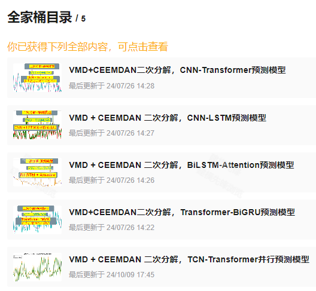
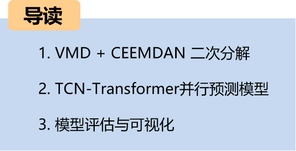
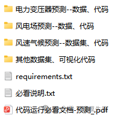
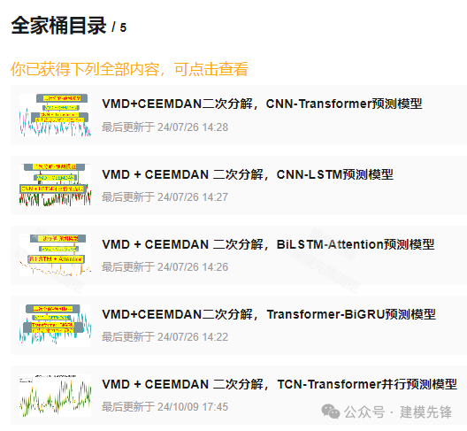

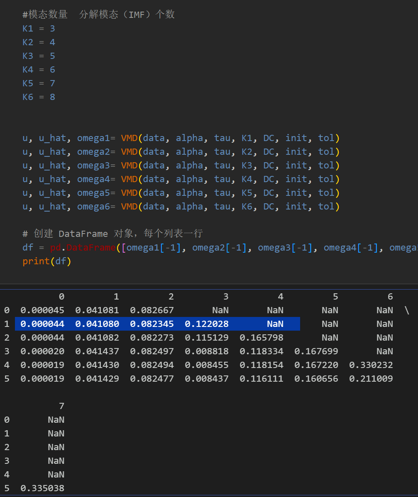

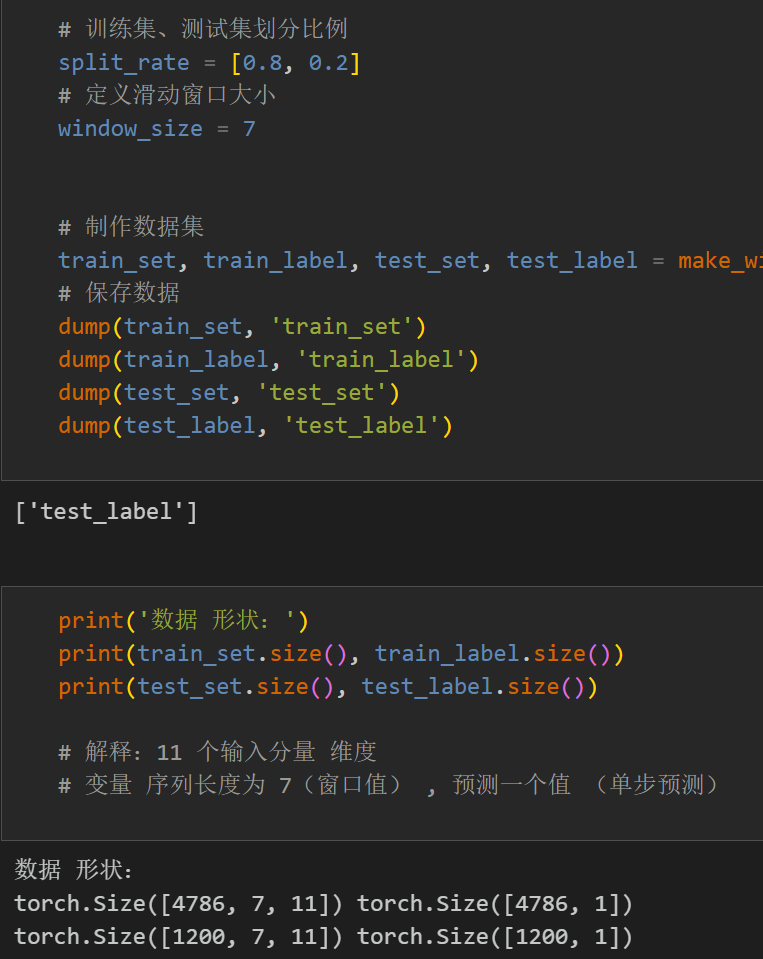

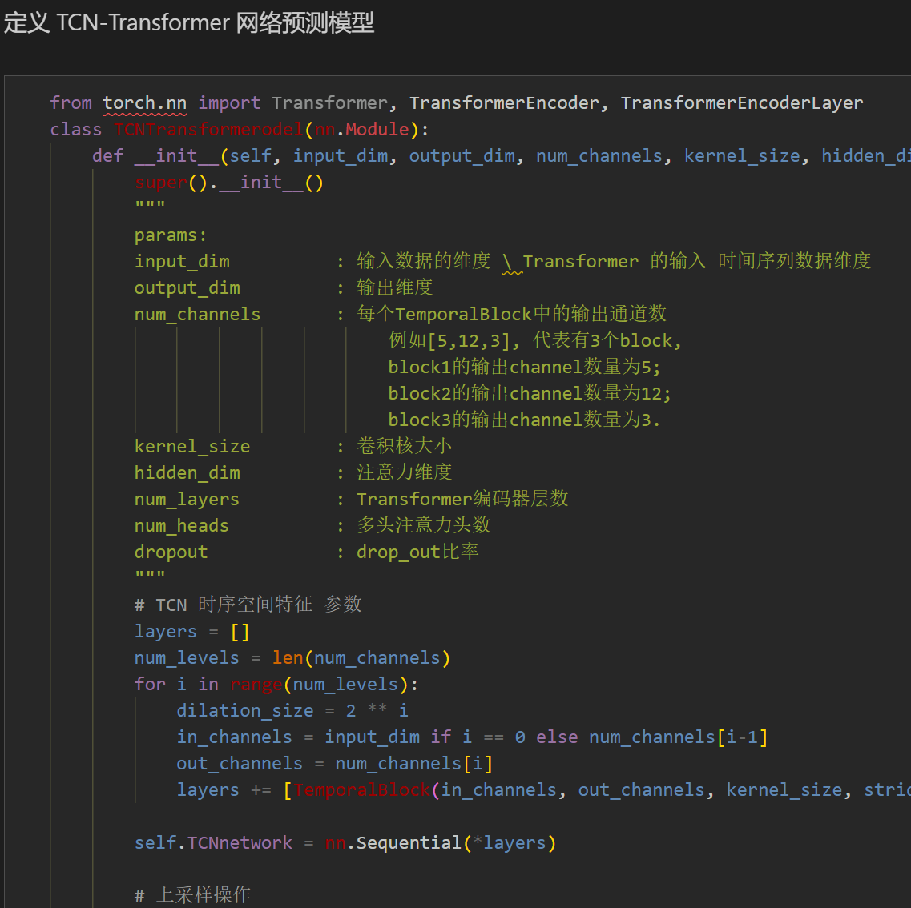
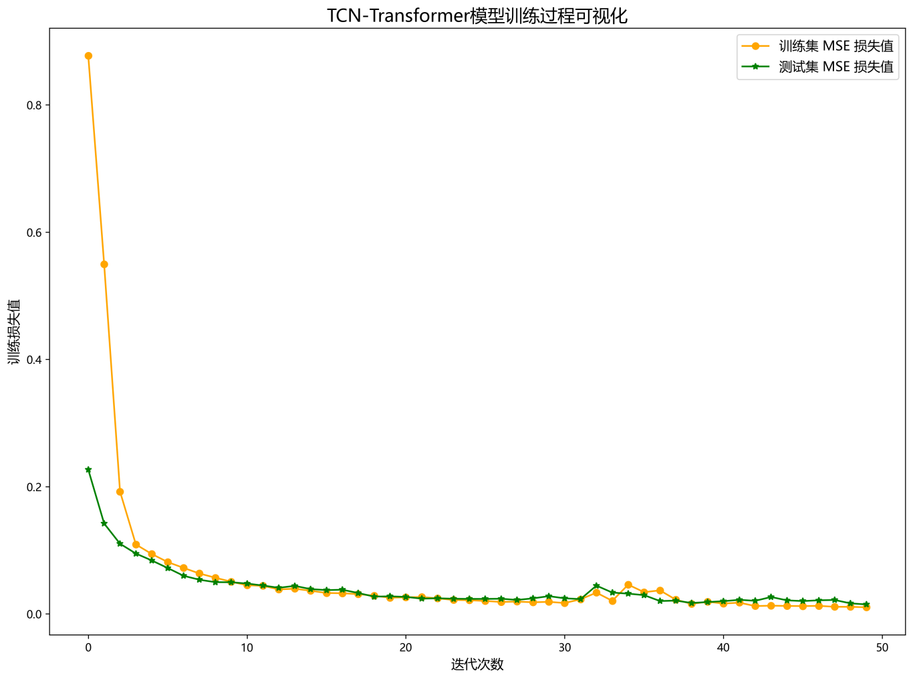

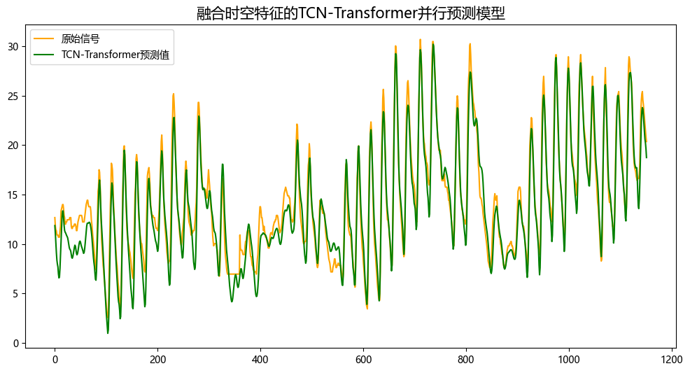
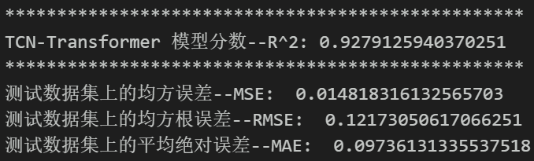
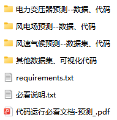

<!-- PAYMENT_BLOCK -->

## Get this dataset

- Payment link (Stripe): [Buy now](https://buy.stripe.com/3cs8yP7sY87d0vu9AB)
- Payment QR code: 

<!-- /PAYMENT_BLOCK -->
